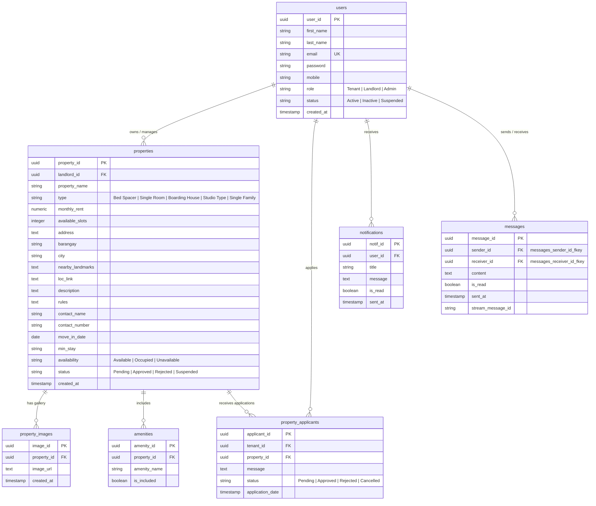

# HousinGo — Database & System Setup Guide

HousinGo is a rental property listing and tenant-landlord communication platform designed for **Brgy. East Rembo, Taguig City**.

---

## 🗄️ Database Architecture

The database is built on **PostgreSQL / Supabase** and comprises 7 interconnected tables:



---

## 🚀 How to Set Up the Database

### Option 1: Supabase (Recommended)

1. Go to your [Supabase Dashboard](https://supabase.com/dashboard).
2. Open your project (or create a new one).
3. Navigate to **SQL Editor** on the left menu.
4. Click **New Query**.
5. Copy the contents of [`database.sql`](./database.sql) and paste it into the editor.
6. Click **Run** (or press `Ctrl+Enter`).
7. Verify that all 7 tables are created in the **Table Editor**.

---

### Option 2: Local PostgreSQL

If you are running PostgreSQL locally or via Docker:

```bash
# Connect to your PostgreSQL instance and execute database.sql
psql -U postgres -d postgres -f database.sql
```

---

## 👥 Demo / Seed Credentials

The database script automatically seeds realistic demo accounts, properties, images, amenities, and messages:

| Role | Name | Email | Password | Mobile |
| :--- | :--- | :--- | :--- | :--- |
| **Admin** | Admin Support | `admin@housingo.com` | `admin123` | `09171234567` |
| **Landlord** | John Doe | `john.doe@email.com` | `landlord123` | `09189876543` |
| **Landlord** | Carlos Reyes | `carlos.reyes@email.com` | `landlord123` | `09223344556` |
| **Tenant** | Maria Santos | `maria.santos@email.com` | `tenant123` | `09995551234` |
| **Tenant** | Juan Dela Cruz | `juan.delacruz@email.com` | `tenant123` | `09192223344` |

---

## ⚙️ Connecting to Frontend (`index.js`)

In [`index.js`](./index.js), ensure your project URL and public Anon key match your Supabase project:

```javascript
const SUPABASE_URL = "https://YOUR_PROJECT_ID.supabase.co";
const SUPABASE_KEY = "YOUR_ANON_PUBLIC_KEY";
const supabase = window.supabase.createClient(SUPABASE_URL, SUPABASE_KEY);
```

---

## 🔒 Security Notes for Production
- In production, switch from plain-text custom password validation to native **Supabase Auth**.
- Replace permissive development RLS policies with role-based policies using `auth.uid()`.
- Store private credentials and API keys in environment variables.
